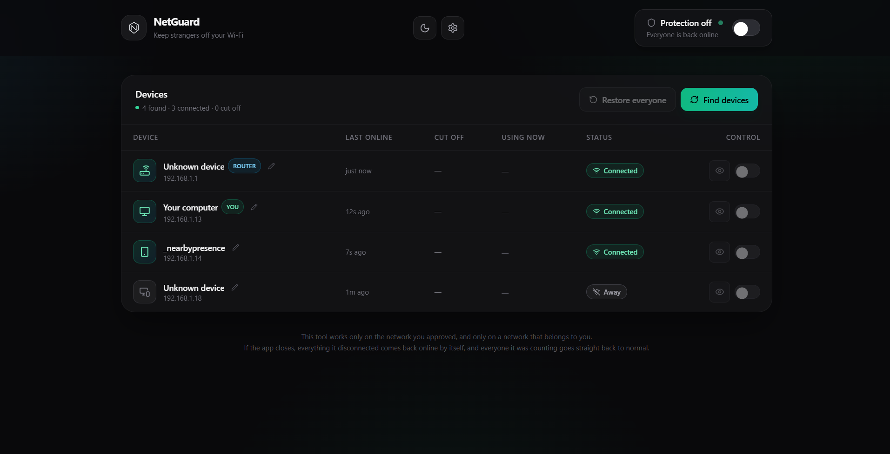
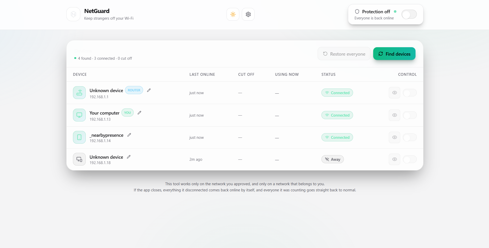

# NShield

[](https://github.com/tebourbimalek/NShield/actions/workflows/ci.yml)
[](LICENSE)
[](https://www.python.org/)
[]()

> **A modern, safety-first network device controller for your own home lab.**
> Discover every device on your subnet, watch them go online/offline live, and
> cut any device's internet with one toggle — NetCut-style isolation, but with
> consent, an allow-list, auto-restore on exit, and a UI anyone can read.

NShield discovers every device on your subnet (ARP scan), streams live status
over a WebSocket, and — with one toggle per device — performs two-way ARP
spoofing (NetCut-style isolation) to cut that device's traffic to the gateway.
Turning the toggle (or the master switch) off sends restoration packets that
fix every touched ARP cache.

**Stack:** Python 3.11+ / Scapy / FastAPI (REST + WebSocket) · React + Vite +
TailwindCSS (dark & light UI, Lucide icons) · the Python process serves the
built frontend, so the whole app is one local URL.

> **Platform note:** NShield is **Windows-first**. Device blocking (ARP/NDP
> spoofing) and the web UI work on Linux/macOS too, but speed caps (Windows
> QoS), the autostart task and the notification balloons are Windows-only.
> See the cross-platform roadmap in `CONTRIBUTING.md`.

---

## ✨ Features

- **One-click isolation** — per-device toggle cuts a phone/laptop off the
  internet; master switch arms/disarms everything at once.
- **Live status** — ARP scan + passive sniffing; devices appear/disappear in
  real time over a WebSocket. No technical jargon anywhere in the UI.
- **Dual-stack blocking** — ARP (IPv4) + NDP (IPv6) poisoning, so a device
  can't sneak out over IPv6.
- **Per-device metering** — checkpoint mode routes a watched device's traffic
  through your PC and counts bytes up/down in KB/s.
- **Speed caps** — Windows QoS throttling on watched devices (KB/s), lifted
  automatically when watching stops.
- **Daily data budgets** — set a MB/day limit per device; over-budget devices
  are cut off automatically until the next day.
- **Usage history & reports** — per-MAC, per-day history that survives
  restarts; export to CSV (7 or 30 days) from the Options panel.
- **Friendly names & icons** — rename devices and pick an icon; remembered
  forever by MAC. Auto-recognition via mDNS/SSDP/NetBIOS/web probes.
- **New-device alerts** — Windows balloon + in-app banner when a stranger
  joins; 24 h dedup so you're not spammed.
- **Phone access** — passcode-gated remote control from any phone on the
  Wi-Fi, with a QR code in Options.
- **Start with Windows** — hidden autostart task (no console window).
- **Relax mode** — flip protection off to let everyone back online instantly.
- **Light & dark themes** — toggle in the header, saved per browser.
- **Speed sparkline** — tiny live graph beside watched devices.
- **Safety guardrails** — consent modal, allow-listed subnets, compliance
  watch, RotatingFileHandler logs (5 MB × 3), auto-restore on exit.

---

## ⚠️ Legal & ethical warning

ARP spoofing cuts traffic of devices on a network you **do not own** just as
easily as on your own. Using NShield on networks without explicit
authorization (school, work, hotel, your landlord's Wi-Fi…) may be **illegal**
(e.g. computer fraud / misuse laws) and is always a serious breach of trust
that can disrupt other people's connectivity.

> **Only use on networks you own or have written permission to manage.
> Unauthorized use may be illegal in your jurisdiction.**

NShield enforces one guardrail for you, but you stay responsible for everything
else:

- The backend **refuses to start** until you list the subnet(s) you own in
  `backend/config.yaml` (`allowed_subnets`), OR confirm the detected network
  in the one-time dialog that appears on a new Wi-Fi. The dialog only offers
  to allow-list the network you are currently connected to.
- The refused subnet is checked again **on every block action**, and blocking
  yourself or the gateway is not possible.
- Every action is written to a local timestamped log file.
- On shutdown / master-switch-off every ARP cache is automatically restored.

Use it only on networks you own or have written permission to test.

---

## 📸 Screenshots

> _Drop screenshots into `docs/screenshots/` and link them here. A 10-second
> GIF of block/unblock + the sparkline is the single biggest driver of stars
> for a tool like this._

| Dark theme | Light theme |
|---|---|
|  |  |

---

## 📁 Project layout

```
nshield/
├── run.bat                      # Windows launcher (self-elevates)
├── run.sh                       # Linux/macOS launcher (re-launches with sudo)
├── stop.bat                     # manual stop (advanced; the desktop icon toggles too)
├── HOW_TO_USE.md                # end-user quick start
├── backend/
│   ├── main.py                  # FastAPI app, REST + WebSocket, static serving, monitor
│   ├── usage.py                 # metered-usage store + quotas + CSV helpers
│   ├── qos.py                   # Windows QoS speed-cap helpers
│   ├── scanner.py               # ARP scan / liveness ping / hostname & vendor lookup
│   ├── spoofer.py               # ARP/NDP spoofing engine (one thread per device)
│   ├── models.py                # Pydantic API models
│   ├── config.example.yaml      # template — copied to config.yaml on first run
│   ├── requirements.txt
│   └── assets/app.ico           # desktop / installer icon
├── frontend/
│   ├── package.json             # Vite + React + Tailwind, pinned versions
│   ├── vite.config.js           # dev proxy: /api → 127.0.0.1:8000 (REST + WS)
│   └── src/                     # App.jsx, DeviceTable.jsx, useDevices.js, index.css …
└── packaging/
    ├── build.bat                # builds frontend + PyInstaller bundle
    ├── nshield.spec            # PyInstaller spec (windowless)
    └── installer.iss            # Inno Setup installer
```

---

## 🚀 Setup

### Windows

1. **Install Npcap** → <https://npcap.com> (defaults are fine; tick *support
   raw 802.11 traffic* only for wireless monitoring).
2. Install **Python 3.11+** (python.org — tick *Add to PATH*) and **Node.js 18+**
   (nodejs.org).
3. Double-click **`run.bat`**. It self-elevates to Administrator, creates the
   venv, installs Python + npm dependencies, builds the frontend, starts the
   server and opens `http://127.0.0.1:8000`.
4. The first start **refuses to run on purpose**: open
   `backend/config.yaml` and allow-list your subnet — see *Configuration*
   below — then start `run.bat` again.

A **NShield** shortcut is created on your Desktop on first run; click it to
start or stop the app afterwards (no console window, ever).

### Linux

```bash
sudo apt install python3 python3-venv python3-pip nodejs npm   # Debian/Ubuntu
sudo ./run.sh
# On Debian/Ubuntu you may need: sudo apt install libpcap-dev
```

### macOS

```bash
brew install python node
sudo ./run.sh
# If ARP sends fail: brew install libpcap, or grant packet capture
# permission to the terminal in System Settings → Privacy & Security.
```

### Manual (any OS, without the launcher)

```bash
python -m venv backend/venv
backend/venv/bin/python -m pip install -r backend/requirements.txt   # Windows: backend\venv\Scripts\pip

# first run only: create your config from the template
cp backend/config.example.yaml backend/config.yaml   # Windows: copy backend\config.example.yaml backend\config.yaml
# then edit backend/config.yaml and allow-list your subnet

cd frontend && npm install && npm run build && cd ..

sudo backend/venv/bin/python backend/main.py    # Windows: run terminal as Administrator
# → http://127.0.0.1:8000
```

For UI development with hot reload: keep the backend running and run
`npm run dev` inside `frontend/` — Vite proxies `/api` (REST + WebSocket) to
port 8000.

---

## ⚙️ Configuration — `backend/config.yaml`

```yaml
allowed_subnets:          # ← NShield REFUSES to start while this is empty!
  - "192.168.1.0/24"      # your own subnet (Windows: `ipconfig`, Linux: `ip -4 r`)
scan_interval: 12         # seconds between live status pings
arp_scan_timeout: 2       # ARP reply wait (seconds)
spoof_interval: 2         # seconds between poison bursts per device
log_file: logs/nshield.log
server_port: 8000
```

If your subnet mask is not a standard /24 (NShield defaults to /24 when the OS
does not expose the mask), just set it here, e.g. `192.168.0.0/23`.

Optional: full vendor names for every NIC — uncomment `manuf` in
`backend/requirements.txt` and reinstall.

---

## 📱 Using the app

1. **Consent modal** — confirm you own the network (saved, shown once per
   browser).
2. **Scan network** — ARP sweep of the allow-listed subnet; results stream in
   as the WebSocket pushes snapshots (passive sniffing keeps status fresh
   between scans).
3. **Master switch** (`Protection active`) — enables/disables all spoofing at
   once. Every row toggle is disabled while protection is idle.
4. **Row toggle** — arms a per-device spoof thread (target and gateway are
   poisoned every 2 s). The device's status pill turns red *Blocked*.
5. **Unblock** or disabling the master switch — and stopping the app —
   immediately sends corrective ARP packets so both ARP caches recover.
6. **Gauge icon** on a watched device — set speed limits (KB/s) and a daily
   data budget (MB).
7. **Gear icon (Options)** — phone access passcode, start-with-Windows,
   alerts, and *Save a report* (CSV of usage, 7 or 30 days).
8. **Sun/Moon icon** — switch between dark and light look.
9. **Action log** — peek at `backend/logs/nshield.log` from the footer.

### Phone access

Enable *Phone access* in Options; a 4-digit passcode is minted. From any phone
on the Wi-Fi, open the LAN URL shown in Options (or scan the QR code). The
passcode is remembered on that phone. A firewall rule ("NShield page") is
toggled with the setting. The passcode is a convenience gate, not a security
boundary — see `SECURITY.md`.

---

## 📦 Building a standalone installer

NShield ships as source. To produce a one-click Windows installer:

```bash
packaging\build.bat          # builds frontend + PyInstaller bundle -> dist\NShield\
```

Then open `packaging\installer.iss` in Inno Setup 6 and compile. The result
is `dist\NShield-Setup.exe`.

---

## 🛠️ Troubleshooting

| Symptom | Fix |
|---|---|
| "NShield is NOT running with elevated privileges" | Windows: start `run.bat` as Administrator. Linux/macOS: `sudo ./run.sh`. |
| Scan finds nothing / scapy errors | Windows: is **Npcap** installed? Linux: `sudo apt install libpcap-dev`. |
| Blocked devices come back online after ~30 s | Some router/APs detect ARP anomalies; NShield re-poisons every 2 s, which normally overrules this. |
| `pip` refuses the pinned scapy version on your Python | `pip install --upgrade scapy` inside the venv — any 2.5+ works. |
| Browser can't connect | Backend runs on `127.0.0.1:8000`; check the console window `run.bat` opened. |

**Note for wireless Linux setups:** some managed-mode Wi-Fi drivers filter
foreign ARP frames. NShield works best where raw ARP injection is allowed —
wired NICs or Wi-Fi adapters with Npcap/home-lab-friendly drivers. All
home-lab traffic goes to *your own* switch/AP only, so nothing you do here
can leave your subnet — another reason the allow-list exists.

---

## 🗺️ Roadmap

- [ ] Schedules (bedtime mode) — per-device auto-disconnect windows.
- [ ] Stranger guard — auto-block unknown devices that join the Wi-Fi.
- [ ] Usage-by-hour bars.
- [ ] Cross-platform caps/firewall/notifications (Linux/macOS).
- [ ] Refactor `main.py` into `state.py` + `routes/`.

---

## 🤝 Contributing

See `CONTRIBUTING.md`. PRs welcome, but `main` is protected: every change
needs **one approving review** (from the maintainer) before it can merge.
Open an issue first for anything non-trivial.

## 🔒 Security

See `SECURITY.md`. NShield is a *local network control tool*; the threat
model assumes the host is trusted and the LAN is yours. The phone-access
passcode is a convenience gate, not a security boundary.

## 📄 License

MIT — see `LICENSE`.

## 🙏 Acknowledgements

Built on [Scapy](https://scapy.net/), [FastAPI](https://fastapi.tiangolo.com/),
[React](https://react.dev/), [Vite](https://vitejs.dev/) and
[Tailwind CSS](https://tailwindcss.com/). Inspired by NetCut, but with the
safety guardrails it never had.
